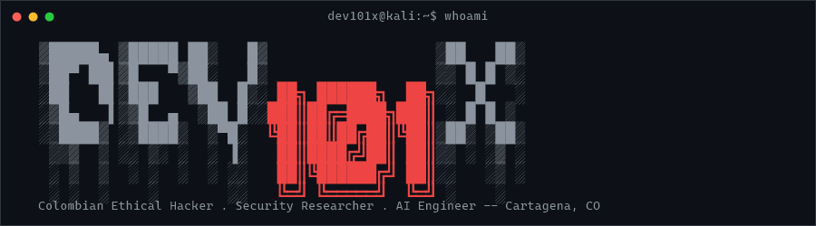
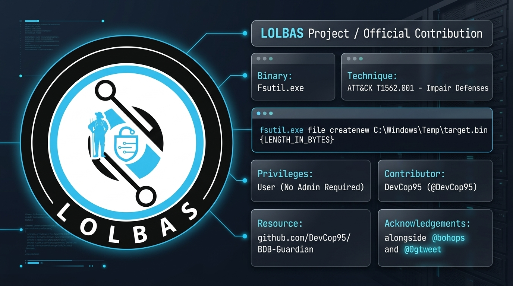
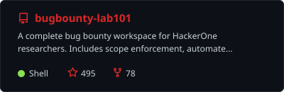
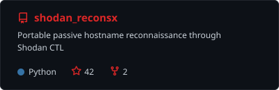
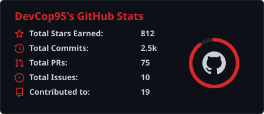
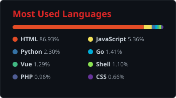
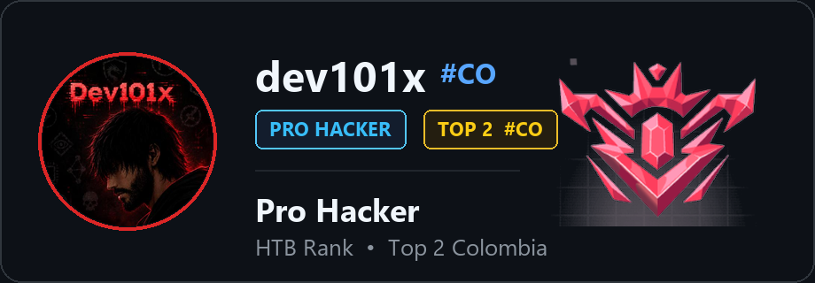

<div align="center">



[](https://dev101x.online/)
[](https://dev101x.online/research/)
[](https://github.com/LOLBAS-Project/LOLBAS/pulls?q=is%3Apr+author%3ADevCop95+is%3Amerged)
[](https://github.com/redcanaryco/atomic-red-team/pulls?q=is%3Apr+author%3ADevCop95+is%3Amerged)
[](https://github.com/Azure/Azure-Sentinel/pull/15693)
[](https://github.com/magicsword-io/LOLRMM/pull/253)
[](https://github.com/soxoj/maigret/pulls?q=is%3Apr+author%3ADevCop95+is%3Amerged)
[](https://www.linkedin.com/in/yared-dev)
[](https://x.com/Devcop101)
[](mailto:yared.henriquezb@gmail.com)
[](https://github.com/DevCop95)

</div>

---

```bash
dev101x@kali:~$ whoami
```

**Yared Henriquez (`DevCop95` / `Dev101x`)** — Security Researcher specializing in **Detection Engineering (Offense-to-Defense)** and **Applied AI Security**, based in **Cartagena, Colombia** 🇨🇴. Currently a Penetration Tester at **Henkel** (Switzerland · Remote) and M.Sc. in Artificial Intelligence candidate at **Universitat de Barcelona**.

```bash
dev101x@kali:~$ cat focus.txt
```

- 🛡️ **Detection Engineering & Threat Emulation:** Full *Offense → Emulation → Detection* lifecycle across Windows LOLBins and RMM tooling (**LOLBAS**, **LOLRMM**, **Red Canary Atomic Red Team**, **SigmaHQ**, **Elastic Security**, **Microsoft Sentinel**) and endpoint kernel-handle correlation (**[`BDB-Guardian`](https://github.com/DevCop95/BDB-Guardian)**, cited by **CUHK ITSC**).
- 🤖 **Applied AI Security:** Multi-layer security review skills for coding agents (**[`cyhber-deploy`](https://github.com/DevCop95/cyhber-deploy)**, Grade A on SkillsDirectory), LLM guardrail robustness evaluation (**[`promt`](https://github.com/DevCop95/promt)**), and upstream AI red-teaming tooling (**`NVIDIA/garak`**).
- 🎯 **Offensive Security & Automation:** Authorized corporate penetration testing, **HackerOne** private programs, and scope-enforced recon/post-exploitation auditing (**[`bugbounty-lab101`](https://github.com/DevCop95/bugbounty-lab101)**, **[`pullgoscript`](https://github.com/DevCop95/pullgoscript)**, **[`shodan_reconsx`](https://github.com/DevCop95/shodan_reconsx)**).
- 🤝 Open to **Detection Engineering**, **Threat Research**, and **Applied AI Security** collaborations — 📫 [yared.henriquezb@gmail.com](mailto:yared.henriquezb@gmail.com).

> ⚠️ **Authorized use only.** Every offensive/security tool linked below is built for use in scoped engagements, CTFs, bug bounty programs and environments the operator owns or is authorized to test. None of it is intended for use against systems without explicit permission.

---

## 🔬 Featured Research (Deep Dives)

1. **[Abusing Windows OpenSSH (`KnownHostsCommand` & `PermitLocalCommand`) and Closing First-Match-Wins Detection Bypasses in KQL & Sigma](https://dev101x.online/research/windows-openssh-indirect-execution/)**  
   `LOLBAS #539/#532` (Merged) → `Azure/Azure-Sentinel #15693` (Merged) → `SigmaHQ #6585` · Covers pre-auth vs. post-auth `ssh.exe` vectors, `-F`/`.ssh/config` child-process lineage, pure-RE2 automaton closing OpenSSH first-match-wins evasion, and 21-case Azure Data Explorer validation (`12/12` TP, `0/9` FP).
2. **[From Disk-Exhaustion DoS against Windows Defender (`fsutil.exe` / BigDiskBuster) to Multi-SIEM & Kernel-Handle Detection](https://dev101x.online/research/bigdiskbuster-fsutil-defense-evasion/)**  
   `BDB-Guardian` (CUHK ITSC cited) → `LOLBAS #525` (Merged) → `Atomic Red Team #3439` (Merged, `T1685`) → `SigmaHQ #6310` (Approved) → `Elastic #6946` (Approved ×2) · Covers native NT vs. LOLBin disk exhaustion, fixing `0xC0000374` (`RM_PROCESS_INFO`) and pipe deadlocks in Win32 handle correlation, safe emulation, and multi-SIEM detection.

---

## 🛡️ Upstream Contributions & Recognition

<div align="center">
  <a href="https://github.com/LOLBAS-Project/LOLBAS/pulls?q=is%3Apr+author%3ADevCop95+is%3Amerged">
    
  </a>
</div>

| Upstream Project | Technique & Emulation Scope | Pull Requests | MITRE ATT&CK / Domain |
|---|---|---|---|
| 🛡️ [**LOLBAS Project · LOLBAS**](https://github.com/LOLBAS-Project/LOLBAS) | `Fsutil.exe` (`file createnew` Defender disk exhaustion) & `Ssh.exe` (`KnownHostsCommand` pre-auth / `PermitLocalCommand` post-auth execution) | [](https://github.com/LOLBAS-Project/LOLBAS/pulls?q=is%3Apr+author%3ADevCop95+is%3Amerged) | [T1685](https://attack.mitre.org/techniques/T1685/) · [T1202](https://attack.mitre.org/techniques/T1202/) |
| ☁️ [**Microsoft · Azure-Sentinel**](https://github.com/Azure/Azure-Sentinel) | `SshIndirectCommandExecution.yaml` M365 Defender KQL hunting query for Windows OpenSSH (`KnownHostsCommand`, `PermitLocalCommand`/`LocalCommand`, `ProxyCommand`, `-F`/`.ssh/config` child lineage & pure-RE2 first-match-wins defense; 21-case ADX `12/12` TP, `0/9` FP) | [](https://github.com/Azure/Azure-Sentinel/pull/15693) | [T1202](https://attack.mitre.org/techniques/T1202/) · [T1059](https://attack.mitre.org/techniques/T1059/) |
| 🔴 [**Red Canary · Atomic Red Team**](https://github.com/redcanaryco/atomic-red-team) | Multi-platform KeePass credential discovery/staging (`KeePass.config.xml`) & Windows Defender `%TEMP%` disk-exhaustion emulation | [](https://github.com/redcanaryco/atomic-red-team/pulls?q=is%3Apr+author%3ADevCop95+is%3Amerged) | [T1555.005](https://attack.mitre.org/techniques/T1555/005/) · [T1685](https://attack.mitre.org/techniques/T1685/) |
| 🗡️ [**magicsword-io · LOLRMM**](https://github.com/magicsword-io/LOLRMM) | AnyDesk custom per-org client coverage (`ad_*`), service normalization, EventLog 7045 telemetry & Sigma detection rules | [](https://github.com/magicsword-io/LOLRMM/pull/253) | [T1219](https://attack.mitre.org/techniques/T1219/) |
| 🕵️ [**soxoj · maigret**](https://github.com/soxoj/maigret) | OSINT false-positive elimination (`Freelance.habr`, `Rlocman`, `Starsonice`/`Terminatorium`, `sanatorii`/`RussianFI`, `Dota2`), Imunify360/Stile HTTP-200 bot-challenge detection & `soupsieve ^4.0` security upgrade | [](https://github.com/soxoj/maigret/pulls?q=is%3Apr+author%3ADevCop95+is%3Amerged) | OSINT · Signal Integrity |

**Active Upstream Review Pipeline:** [`elastic/detection-rules #6946`](https://github.com/elastic/detection-rules/pull/6946) (`APPROVED` ×2) · [`SigmaHQ/sigma #6310`](https://github.com/SigmaHQ/sigma/pull/6310) & [`#6323`](https://github.com/SigmaHQ/sigma/pull/6323) (`APPROVED`, awaiting 2nd review) + [`#6585`](https://github.com/SigmaHQ/sigma/pull/6585) · [`NVIDIA/garak #2357`](https://github.com/NVIDIA/garak/pull/2357) (`22/22` CI).

---

## 🚀 Security & AI Engineering Arsenal

<div align="center">

[](https://github.com/DevCop95/bugbounty-lab101)
<br>
[](https://github.com/DevCop95/bugbounty-lab101/stargazers)
[](https://github.com/DevCop95/bugbounty-lab101/network/members)

<br>

[](https://github.com/DevCop95/shodan_reconsx)
<br>
[](https://github.com/DevCop95/shodan_reconsx/stargazers)
[](https://github.com/DevCop95/shodan_reconsx/network/members)

</div>

| Project | Stack | Description |
|---|---|---|
| 🏹 [**bugbounty-lab101**](https://github.com/DevCop95/bugbounty-lab101) | `Shell` · `Recon` | Scope-enforced bug bounty workspace: automated recon/vuln pipeline, report templates, CVE/CWE watchlists |
| 🛡️ [**BDB-Guardian**](https://github.com/DevCop95/BDB-Guardian) | `PowerShell` · `Win32/C#` | Windows Defender DoS defensive monitor correlating `MRT.exe` + volume handles (cited by CUHK ITSC, LOLBAS #525 & Atomic #3439) |
| 🔒 [**pullgoscript**](https://github.com/DevCop95/pullgoscript) | `Go` · `Assembly` | Windows credential-exposure audit toolkit & hardened `127.0.0.1` console with fuzzing & `gosec` (`T1003`/`T1555`/`T1547`/`T1055`) |
| 🤖 [**cyhber-deploy**](https://github.com/DevCop95/cyhber-deploy) | `Python` · `AI Sec` | Multi-layer security review skill for AI coding agents (`Grade A` on SkillsDirectory; packaged in `agents.nix`) |
| 🔍 [**shodan_reconsx**](https://github.com/DevCop95/shodan_reconsx) | `Python` · `OSINT` | Zero-dependency passive hostname reconnaissance via `ctl.shodan.io` (`unittest` + CI) |
| 🧪 [**dev101x-pentest-lab**](https://github.com/DevCop95/dev101x-pentest-lab) | `Docker` · `Python` | Self-contained Pro Lab box: blind SQLi → internal network pivot → SUID privesc, with live flag engine |

---

## 🛠️ Tech Stack

<div align="center">

**Detection & Threat Engineering**


**Systems, Offensive & Applied AI**


</div>

---

## 💼 Experience

| Period | Role | Company |
|---|---|---|
| 2026 — present | 🛡️ Penetration Tester | Henkel · Switzerland (Remote · Part-time) |
| 2022 — 2025 | 🏢 Chief Technology Officer | EXIA S.A.S — Cartagena, CO |
| 2021 — 2024 | 💻 Associate Software Developer (QA & Testing) | Google (Affiliate / Extended Workforce) |
| 2020 — present | 🚀 Freelance · Offensive Security & AI | Independent |

## 🎓 Education

| Period | Degree | Institution |
|---|---|---|
| 2024 — present | 🤖 Master's in Artificial Intelligence | Universitat de Barcelona |
| 2017 — 2021 | 🎓 Systems & Computer Engineering | Universidad Tecnológica de Bolívar |
| 2013 — 2017 | 💡 Systems & Computer Technology | Universidad Tecnológica de Bolívar |

---

## 📊 GitHub Stats

<div align="center">


&nbsp;


</div>

---

## 🎯 HackTheBox

<div align="center">

<a href="https://profile.hackthebox.com/profile/019f8d0f-a8d2-73bb-8f12-d863b7261aa3">
  
</a>

<br>

[](https://profile.hackthebox.com/profile/019f8d0f-a8d2-73bb-8f12-d863b7261aa3)
[](https://profile.hackthebox.com/profile/019f8d0f-a8d2-73bb-8f12-d863b7261aa3)
[](https://profile.hackthebox.com/profile/019f8d0f-a8d2-73bb-8f12-d863b7261aa3)

<sub>Snapshot from November 2026 · click the card for live stats</sub>

</div>

---

<div align="center">

<i>"Security is not a product, but a process. Code is poetry. Ship it."</i>

<sub>⭐️ From <a href="https://github.com/DevCop95">DevCop95</a> · Detection Engineering &amp; Applied AI Security · Cartagena, Colombia 🇨🇴</sub>

</div>
